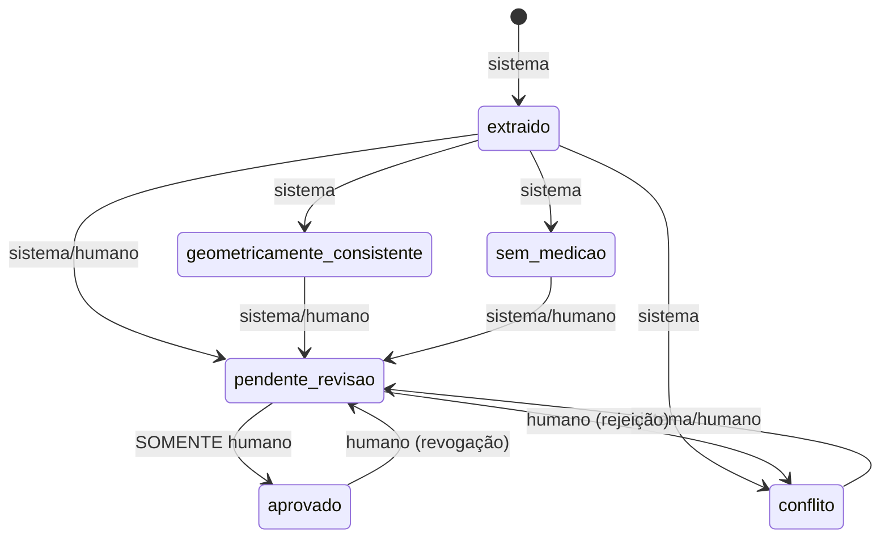

# Etapa 1 — Seis estados e modelo de saída rastreável

Código: `ingest/technical/` · Testes: `tests_py/test_technical.py` (106) · Esquema: `ingest/technical/schema/resultado.schema.json`

## 1. Escopo

Esta etapa **não otimiza** o algoritmo de cotas. Ela cria a estrutura sobre a qual o interpretador técnico será construído:

- seis estados com transições controladas;
- um modelo de saída que preserva origem, página, coordenadas, método, confiança e evidências;
- um registro separado de decisões humanas;
- a prova de que tudo isso reproduz **exatamente** os resultados da linha de base da Etapa 0.

O algoritmo avaliado continua sendo `ingest/dimensions.py`, **inalterado** (cópia congelada e idêntica em `evaluation/baseline_etapa0/`).

## 2. Os seis estados

| Estado | Significado | Quem leva a ele |
|---|---|---|
| `extraido` | Número lido do documento; nenhuma verificação feita (ex.: fonte sem geometria, como OCR) | sistema (criação) |
| `geometricamente_consistente` | A geometria **não contradiz** o valor escrito. **Não é aprovação.** | sistema |
| `conflito` | A geometria contradiz o valor escrito, **ou** um humano rejeitou | sistema / humano (rejeição) |
| `sem_medicao` | Não foi possível medir/verificar pela geometria | sistema |
| `pendente_revisao` | Aguardando decisão humana | sistema ou humano |
| `aprovado` | Confirmado por um **humano identificado** | **somente humano**, a partir de `pendente_revisao` |



Qualquer par (estado atual, novo estado, tipo de ator) fora desta tabela é **proibido** (`TransicaoProibida`). A tabela é a constante `PERMITIDAS` em `model.py` e é testada de forma exaustiva (72 combinações).

## 3. Como o modelo impede a aprovação automática

1. **Único caminho:** o único par com destino `aprovado` é `(pendente_revisao → aprovado)`, e só para ator `humano`.
2. **`estado` não é um campo gravável:** é derivado da última transição do histórico. Não existe `m.estado = ...`.
3. **Imutabilidade:** histórico, evidências e conflitos são tuplas; qualquer escrita direta levanta `AttributeError`. As mudanças só ocorrem pelos métodos (`transitar`, `aprovar`, `rejeitar`, `revogar`), que revalidam os invariantes e **revertem** se falharem.
4. **Identificação humana:** o revisor não pode ser vazio nem `sistema`, `IA`, `claude`, `algoritmo`, `auto` etc.
5. **Carregamento de JSON:** o `estado` declarado precisa coincidir com o histórico, cada transição do histórico precisa ser legal e `aprovado` exige revisão humana registrada. JSON adulterado é recusado.
6. **Resumo auditável:** `resumo.aprovadas_automaticamente` existe apenas para provar que é sempre `0`; o `Resultado` não é construído se for diferente.
7. **Análise preservada:** `analise_automatica` guarda o que o algoritmo concluiu e **nunca** é sobrescrita por uma decisão humana.

Um erro real encontrado e corrigido durante a implementação: a primeira versão guardava `estado` como campo comum com `validate_assignment`; o pydantic gravava o valor **antes** de a validação falhar, deixando o objeto `aprovado` mesmo com a exceção. A causa foi removida (estado derivado + imutabilidade + reversão) e há teste de regressão. Há também verificação de mutação (quebrar a regra em memória e confirmar que a suíte falha).

## 4. Modelo de saída (`Resultado` → `Medida`)

Por medida:

| Campo | Conteúdo |
|---|---|
| `id` | estável: `m-<sha8 do arquivo>-p<página>-<x>x<y>-<texto>` |
| `documento` | arquivo, SHA-256 e nº de páginas |
| `pagina`, `coords` | página (1-based) e caixa do texto em pontos, origem no topo esquerdo |
| `texto_original` | exatamente como aparece no documento |
| `valor_normalizado`, `unidade`, `unidade_fonte` | número e unidade; `declarada_na_pagina` (texto "COTAS EM MILÍMETROS" etc.) ou `assumida` (mm, **sinalizado**) |
| `orientacao`, `angulo_graus` | do ângulo real do texto (`inclinada` quando não é 0/90/180/270 ±2°) |
| `metodo_extracao`, `confianca` | `text-layer`; confiança da **leitura do número** (não da medida) |
| `estado`, `historico` | estado atual e todas as transições (de, para, ator, instante, motivo) |
| `analise_automatica` | o que o algoritmo concluiu (estado + rótulo original + hash do algoritmo) |
| `evidencias` | `leitura`, `unidade`, `geometria` / `conflito_geometrico` / `sem_medicao`, `orientacao`, `revisao_humana` |
| `conflitos` | divergências encontradas (valor escrito × geometria, sugestão **não aplicada**) |
| `revisao` | revisor, decisão, instante, observação, valor confirmado |
| `vista`, `componente` | **nulos nesta etapa** (determinados nas próximas) |

Cada evidência de geometria traz escala (mm/pt), comprimento e intervalo medidos (pt), valor geométrico, desvio absoluto e relativo, tolerância usada e uma **ressalva**: "consistência geométrica NÃO é aprovação". Para `confirmado_local`, a evidência declara que a escala vem do próprio par e que o desvio é nulo por construção (`verificacao_independente: false`).

## 5. Registro de revisões humanas (`revisao.py`)

- Arquivo JSONL **append-only**, separado da análise. Cada entrada leva `hash_anterior` e `hash` (SHA-256 encadeado): alterar, remover, reordenar ou inserir entradas quebra a cadeia (`RegistroAdulterado`).
- Uma decisão só é aplicada se **documento (hash), página, texto e posição** da medida baterem. Se o arquivo mudou, a aprovação deixa de valer (`nao_aplicadas`, com o motivo).
- A última decisão humana prevalece; uma rejeição posterior a uma aprovação a **revoga**, e tudo permanece no histórico.
- Aplicar o mesmo registro duas vezes é idempotente.

## 6. Comparação com a baseline

`evaluation/adapters.py` converte o `Resultado` em objetos no formato do baseline, usando a **análise automática preservada** (decisões humanas não alteram a comparação). Testes provam:

- os 60 resultados sintéticos e os 104 do PDF real da Etapa 0 são **idênticos**, item a item;
- os estados batem com os status do baseline (`confirmado`+`confirmado_local` → `geometricamente_consistente`; `conflito` → `conflito`; `sem_medicao`+`sem_escala` → `sem_medicao`).

Para avaliar uma etapa futura contra a mesma base: gere o `Resultado` com o novo algoritmo (`analisar_pdf(..., geometria=modulo_novo)`), passe por `dims_from_resultado` e use `evaluation.metrics`.

## 7. Uso

```bash
python -m ingest.technical analisar projeto.pdf resultado.json [--enfileirar]
python -m ingest.technical decidir registro.jsonl resultado.json --medida ID --decisao aprovado --revisor "Nome Sobrenome" [--obs "..."]
python -m ingest.technical aplicar resultado.json registro.jsonl final.json
```
Códigos de saída: `2` medida inexistente · `3` registro adulterado · `4` entrada inválida (ex.: revisor não humano).

## 8. Limitações conhecidas (leia antes de confiar)

- **Identidade do revisor não é autenticada.** O nome é um texto. A etapa garante que o **sistema** não aprova e que o registro é à prova de adulteração *posterior*; não impede alguém com acesso ao arquivo de **criar** uma entrada nova com outro nome. Autenticação/assinatura é decisão de produto para antes de produção.
- **Posição da linha de cota é aproximada** (o algoritmo da Etapa 0 expõe só o intervalo); a evidência declara isso.
- **Herda todas as falhas medidas na Etapa 0** (cotas deslocadas, texto abaixo da linha, decimais, unidades, inclinadas, escala espúria). Esta etapa as **registra**, não as corrige.
- **Unidade assumida** em páginas sem declaração (sinalizada em cada medida).
- **Vista e componente** ainda não existem.
- Só lê a camada de texto de PDF vetorial; imagens e scans ficam fora (apenas `extraido`, se ligados no futuro).
- O gabarito da Etapa 0 ainda **não teve revisão independente** (folha de conferência pronta em `evaluation/review/`).
